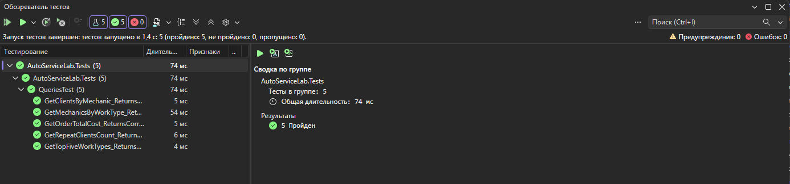

# Разработка корпоративных приложений
## Выполнил
- **Имя**: Рыжков Михаил
- **Группа**: 6411
- **Вариант**: 18 (Автосервис, PostgreSQL, NATS)

## Описание проекта
Учебный проект по дисциплине «Разработка корпоративных приложений». 
В рамках проекта реализована объектная модель данных для предметной области «Автосервис», а также серверное приложение (REST API) для работы с ней.

## Технологии
- **.NET 10**
- **ASP.NET Core Web API**
- **xUnit v3** 
- **Scalar** 

## Архитектура проекта
- **Domain** — Сущности (Entities), перечисления (Enums) и интерфейсы репозиториев
- **Application.Contracts** — DTO (Data Transfer Objects) и интерфейсы сервисов
- **Application** — Бизнес-логика (сервисы, аналитика)
- **Infrastructure.InMemory** — Реализация репозиториев для хранения данных в памяти
- **Api** — Контроллеры и настройка приложения
- **Tests** — Юнит-тесты

## Лабораторная работа №1: Классы
Реализована объектная модель (клиенты, машины, механики, заказы, виды работ). 
- Создан `DataSeeder` с 10+ экземплярами каждого класса.
- Написаны 5 юнит-тестов на LINQ-запросы (проверка аналитики).
- Настроен GitHub Actions для автоматического запуска тестов.

## Лабораторная работа №2: Сервер
Реализован серверный слой (REST API).
- Добавлены базовые CRUD-операции для всех сущностей.
- Реализованы аналитические эндпоинты (5 запросов из 1-й лабы).
- Настроена документация с помощью Scalar.
- Внедрено логирование через `ILogger`.

## Запуск проекта

### 1. Запуск API
```bash
dotnet run --project AutoServiceLab.Api
```

### 2. Запуск тестов
```bash
dotnet test
```

## Результаты тестов



